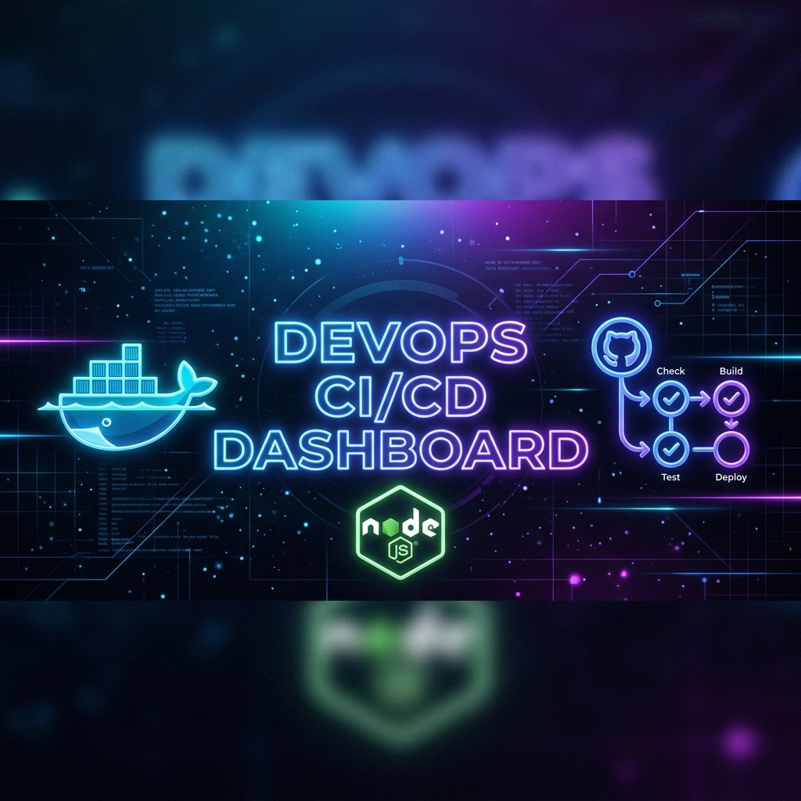

<div align="center">
  

  # 🚀 DevOps CI/CD Dashboard

  [](https://github.com/Anas15161/devops-ci-cd-dashboard/actions)
  [](https://nodejs.org/)
  [](https://expressjs.com/)
  [](https://www.docker.com/)
  [](https://jestjs.io/)
  [](https://github.com/features/actions)
  [](https://opensource.org/licenses/ISC)

  <p align="center">
    <strong>A premium, fully-automated DevOps CI/CD workflow and real-time dashboard.</strong><br />
    Designed to demonstrate professional software delivery practices using Node.js, Jest, multi-stage Docker builds, and automated GitHub Actions pipelines.
  </p>
</div>

---

## 📖 Project Overview

This repository showcases a complete DevOps pipeline built around a modular **Node.js/Express web dashboard**. The dashboard provides real-time application uptime, request counters, health status, and live CI/CD build metadata injected directly during compilation.

#### ✨ Key Features
* 📊 **Interactive DevOps Dashboard**: Accessible at `/` with real-time performance indicators and system details.
* 📂 **Architecture Explorer**: Live code-line explorer at `/explorer.html` detailing the DevOps significance of every line of code.
* 🧪 **Visual Test Suite**: Dynamic visualization of Jest test cases and coverage statistics at `/tests`.
* 🤖 **Fully-Automated CI/CD**: Clean GitHub Actions workflow executing testing, container builds, and deployment.
* 🐳 **Optimized Conteneurisation**: Multi-stage `Dockerfile` leveraging Alpine Linux to reduce final image size by **88%** (from ~900MB to ~110MB).
* 🛠️ **Local Orchestration**: Pre-configured `Makefile` and `docker-compose.yml` for single-command environments.

---

## 🏗️ System Architecture & Pipeline Flow

The following diagram illustrates the linear automated lifecycle of the application, from local development commits to production containers:

```mermaid
sequenceDiagram
    autonumber
    actor Dev as Developer
    participant Git as GitHub Repo
    participant GA as GitHub Actions (CI/CD)
    participant DH as Docker Hub (Registry)
    participant Prod as Production Host

    Dev->>Git: git push (to main branch)
    activate Git
    Note over GA: Triggered automatically
    Git-->>GA: Run CI/CD Pipeline
    deactivate Git
    activate GA

    rect rgb(30, 41, 59)
        Note over GA: Stage 1: Integration & Unit Tests
        GA->>GA: Install dependencies
        GA->>GA: Run Jest & Supertest suites
    end

    rect rgb(13, 148, 136)
        Note over GA: Stage 2: Optimized Docker Build
        GA->>GA: Run multi-stage Docker build
        GA->>GA: Inject build metadata (SHA, date, version)
    end

    GA->>DH: Push tagged production image
    deactivate GA
    activate DH
    Note over DH: devops-ci-cd-dashboard:latest
    DH-->>Prod: Pull latest image
    deactivate DH
    activate Prod
    Note over Prod: Re-launch container
    Prod-->>Dev: Live Dashboard updated!
    deactivate Prod
```



---

## 📡 API Endpoints

The backend provides several JSON endpoints monitored by the dashboard:

| Endpoint | Method | Description | Sample Response |
| :--- | :--- | :--- | :--- |
| `/api/health` | `GET` | System health check indicators | `{"status":"UP", "timestamp":"..."}` |
| `/api/metrics` | `GET` | Live runtime uptime and request counts | `{"uptime": 128, "requests": 42}` |
| `/api/build-info` | `GET` | Metadata injected at build time | `{"version":"1.1.0", "commit":"a1c4bc7", ...}` |
| `/api/version` | `GET` | Current package release version | `{"version":"1.0.0"}` |

---

### 🛠️ Installation & Local Setup

Get the project running locally in less than 2 minutes using Node.js or Docker.

<details>
<summary><b>🚀 Running with Node.js locally (without Docker)</b></summary>

### Prerequisites
* **Node.js** (v20 or higher)
* **npm**

### Steps
1. **Clone the repository:**
   ```bash
   git clone https://github.com/Anas15161/devops-ci-cd-dashboard.git
   cd devops-ci-cd-dashboard
   ```

2. **Configure environment variables:**
   ```bash
   cp .env.example .env
   ```

3. **Install dependencies:**
   ```bash
   npm install
   ```

4. **Run unit tests:**
   ```bash
   npm test
   ```

5. **Start development server:**
   ```bash
   npm start
   ```
   Open **[http://localhost:3000](http://localhost:3000)** in your browser.
</details>

<details>
<summary><b>🐳 Running with Docker and Docker Compose</b></summary>

### Prerequisites
* **Docker Engine** & **Docker Compose**

### Steps
1. **Build the container and run detached:**
   ```bash
   docker compose up -d --build
   ```
   *(Or simply run `make run` if you have Make installed).*

2. **Verify running logs:**
   ```bash
   docker compose logs -f
   ```

3. **Shutdown container:**
   ```bash
   docker compose down
   ```
   *(Or simply run `make stop`).*
</details>

<details>
<summary><b>🛠️ Makefile Automation Cheat Sheet</b></summary>

A Makefile is provided to abstract docker commands and make local development seamless:

```bash
make install  # Installs npm dependencies locally
make test     # Runs test suite with Jest
make build    # Builds local Docker image (devops-ci-cd-dashboard)
make run      # Starts docker-compose services
make stop     # Shuts down docker-compose services
make clean    # Cleans node_modules and coverage reports
```
</details>

---

## 🤖 CI/CD Workflow & GitHub Secrets

The automation pipeline defined in `.github/workflows/main.yml` executes on every push to the `main` branch.

To enable the pipeline, configure the following **Secrets** under your GitHub repository (`Settings > Secrets and variables > Actions`):

* `DOCKERHUB_USERNAME`: Your Docker Hub profile handle.
* `DOCKERHUB_TOKEN`: Personal Access Token from Docker Hub settings.
* `RENDER_DEPLOY_HOOK`: *(Optional)* Deploy trigger webhook for hosting platforms.

---

## 📂 Project Structure

```text
├── .github/workflows/   # CI/CD Pipeline definition (GitHub Actions)
├── src/                 # Application codebase
│   ├── public/          # Frontend files (HTML, CSS, JS routing)
│   │   ├── explorer.html# Interactive codebase analyzer UI
│   │   └── index.html   # Live Metrics Dashboard UI
│   ├── routes/          # Express route declarations
│   ├── controllers/     # Controller layer handling requests
│   ├── services/        # Service layer managing metrics
│   ├── app.js           # Express App configuration
│   └── server.js        # Main server entrypoint
├── tests/               # Automated unit tests (Jest & Supertest)
├── Dockerfile           # Optimized multi-stage build script
├── docker-compose.yml   # Docker compose configuration
├── Makefile             # Standard automation scripts
├── report.tex           # Technical report source (LaTeX)
└── README.md            # Repository documentation (this file)
```

---

## 👥 Authors & Academic Context

* **Student Developers**: 
  * **Anas Haddou** & **Amine Mohammed Tayek**
* **Supervisor**: **Pr. Mohtaram**
* **Institution**: **École Marocaine d'Ingénierie** (Filière Ingénierie Informatique)
